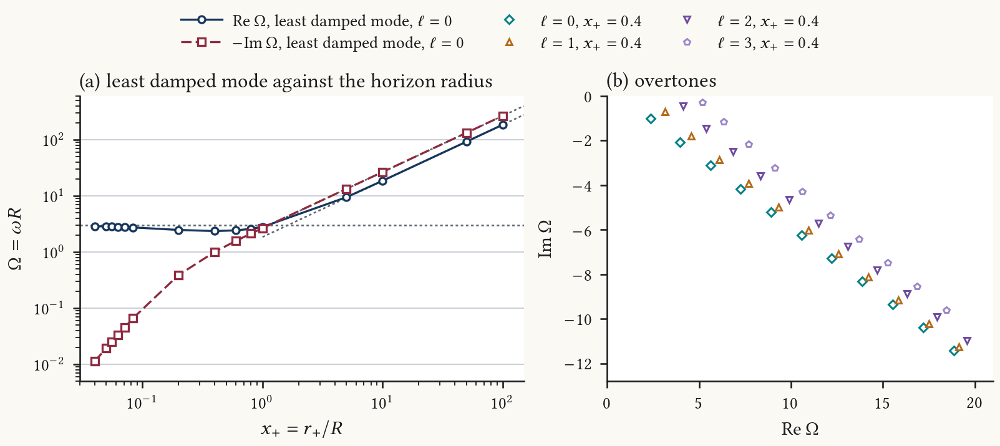

<!-- Davide Batic (Mathematics Department, Khalifa University of Science and Technology, Abu Dhabi, UAE), Alan S. Cornell (Department of Physics, University of Johannesburg, Auckland Park, South Africa), Dr. Denys Dutykh (Mathematics Department, Khalifa University of Science and Technology, Abu Dhabi, UAE) -->

# schwarzschild-ads: scalar quasinormal modes of Schwarzschild–anti-de Sitter black holes



Scalar quasinormal modes Ω = ωR with the vanishing-field condition at the AdS boundary, read from the tables of
`reports/s0-vanishing-AdS-boundary/`. Panel (a) shows the least damped mode of ℓ = 0 against the horizon radius
x₊ = r₊/R, on logarithmic axes: for small black holes its real part tends to 3, the lowest normal mode of pure AdS
(dotted line), while its damping rate vanishes; for large black holes both grow linearly, with Ω/x₊ ≈ 1.85 − 2.66i
(dotted lines; 1.8495 − 2.6639i at x₊ = 100). Panel (b) shows the overtones of ℓ = 0, 1, 2 and 3 at x₊ = 0.4 with
Re Ω ⩽ 20 and Im Ω ⩾ −12, which form nearly straight and parallel ladders.

This repository holds the Maple worksheets, the Julia solvers and the computed spectra of the article by Davide Batic,
Alan S. Cornell and Denys Dutykh in The European Physical Journal C (2026), cited below, on the quasinormal modes of a
massless scalar field around four-dimensional Schwarzschild–anti-de Sitter black holes. The exterior of the black hole
is compactified, the behaviour of the modes at the horizon and at the AdS boundary is factored out, and a Chebyshev
collocation turns the radial equation into a quadratic matrix pencil, assembled in Maple with 200 decimal digits and
solved in Julia with 220 digits at three resolutions, keeping the roots on which they agree. Two boundary conditions
are treated: the standard vanishing field at the AdS boundary, and a one-parameter relation between the two
coefficients of the field at large radius, which the article studies as a formal deformation. The tables of 48 cases
are stored in `reports/`.

## The problem

With the horizon radius r₊, the AdS radius R and the time dependence exp(−iωt), the computations use

```text
x₊ = r₊/R,      Ω = ωR,
```

and, after the exterior is compactified and the behaviour of the modes is factored out, the collocation gives the
quadratic pencil

```text
( M0 + i Ω M1 + Ω² M2 ) a = 0.
```

The Julia solvers linearise the pencil into a generalised eigenvalue problem, keep its finite eigenvalues, and match
them across three resolutions: a root is kept when the three nearest roots lie within max(10⁻⁴, 10⁻⁴ · max(1, |Ω|)) of
each other, and the tables give their average. A mode is damped when Im Ω < 0, growing when Im Ω > 0 and neutral when
Im Ω vanishes within the tolerance of the solver.

The standard calculation imposes a vanishing field at the AdS boundary. The generalised one imposes

```text
A cos θ + B sin θ = 0,
```

where A and B are the two independent coefficients of the expansion of the field at large radius. This relation is the
deformation studied in the article: for a massless scalar in four dimensions the slow branch lies outside the standard
domain of finite energy, so the spectra obtained for θ ≠ 0 are formal ones, and the growing modes they contain do not
establish a physical instability of the scalar field (see the abstract and the discussion of the article). It is not to
be confused with the usual alternative quantisation of a scalar in the Breitenlohner–Freedman window.

The repository covers the scalar sector (s = 0) only. The Julia solvers carry labels and checks for s = 0, 1 and 2,
but the worksheets and tables of the repository are those of the scalar field, and no electromagnetic or
gravitational result can be read from them.

## Quick start

First, in Maple, open the assembler of the boundary condition wanted, `Matrix_Assembler_s0_SAdS-Final Version.mw` for
the vanishing field or `Matrix_Assembler_s0_SAdS-Final Version-BC2.mw` for the generalised relation, choose the
multipole, the horizon radius, the angle θ where needed and three resolutions, set an output folder and execute the
worksheet. It writes the matrices `M0-<N>-<tag>.mat`, `M1-<N>-<tag>.mat` and `M2-<N>-<tag>.mat`, where N is a
resolution and the tag records the sector, the multipole, the horizon radius (both as a decimal `xp` value and as the
integer `a = 1000 x₊`) and the angle. These matrices are not stored in the repository.

Second, run the Julia solver of the same condition from the root of the repository, giving through environment
variables the folder of the matrices and the parameters used in Maple (the default data folder of each program is a
folder of the authors' computer, so `SADS_DATA_DIR` must always be set):

```bash
export SADS_DATA_DIR=/absolute/path/to/standard-matrices
export SADS_OUT_DIR="$PWD/output/standard-s0-L0-xp1"
export SADS_SPIN=0
export SADS_ELL=0
export SADS_XPLUS=1
export SADS_N_VALS=90,95,100
julia --threads=auto julia/SAdS_scalar_qnm_solver.jl
```

For the generalised condition, the angle is given as a rational multiple of π (here θ = π/4):

```bash
export SADS_DATA_DIR=/absolute/path/to/generalized-bc-matrices
export SADS_OUT_DIR="$PWD/output/generalized-s0-L0-xp1-th1over4pi"
export SADS_SPIN=0
export SADS_ELL=0
export SADS_XPLUS=1
export SADS_THETA=1/4
export SADS_N_VALS=190,195,200
julia --threads=auto julia/SAdS_scalar_qnm_solver_generalized_bc_fixed.jl
```

The generalised solver also accepts the forms `pi/4`, `1over4` and `th1over4pi`. When the automatic detection of the
tag does not match the names written by Maple, `SADS_THETA_TAG` or the complete `SADS_FILETAG` can be set. Each
program checks that the nine matrix files exist before solving. A run writes into `SADS_OUT_DIR` the finite and the
filtered spectra at each resolution, the table of retained modes `stable_modes-<tag>.txt` with a detailed and a
full-precision companion, separate tables of the damped, growing, neutral, oscillatory and purely imaginary modes, and
pictures of the spectra (PNG, and HTML when the PlotlyJS backend is available). A tag such as
`s0_L0_xp1_a1000_th1over4pi` stands for the scalar sector, ℓ = 0, x₊ = 1 (a = 1000) and θ = π/4.

The variables read by the two programs are

| Variable | Meaning | Default, standard solver | Default, generalised solver |
| --- | --- | --- | --- |
| `SADS_DATA_DIR` | folder of the Maple matrices | a folder of the authors' computer | a folder of the authors' computer |
| `SADS_OUT_DIR` | folder of the tables and pictures | `<DATA_DIR>/Julia/<FILETAG>` | `<DATA_DIR>/Julia/<FILETAG>` |
| `SADS_SPIN` | perturbation sector | `0` | `0` |
| `SADS_ELL` | multipole ℓ | `0` | `3` |
| `SADS_XPLUS` | horizon radius x₊ = r₊/R | `50` | `50` |
| `SADS_N_VALS` | the three resolutions | `90,95,100` | `190,195,200` |
| `SADS_FILETAG` | complete tag of the matrix files | detected | detected |
| `SADS_XPLUS_TAG`, `SADS_ATAG` | parts of the tag for x₊ and for a = round(1000 x₊) | derived | derived |
| `SADS_THETA`, `SADS_THETA_TAG` | angle of the generalised condition and its tag | not used | `0`, derived |

and the constants near the top of each file document the others: the digits of the matrix files and of the arithmetic
(`SADS_FILE_DECIMAL_DIGITS`, 200, and `SADS_WORK_DECIMAL_DIGITS`, 220), the matching tolerances (`SADS_STABLE_RELTOL`
and `SADS_STABLE_ABSTOL`, both 10⁻⁴), the filters of the zero mode and of the damping, the classification of the modes,
the plotting backend (`SADS_USE_PLOTLYJS`, true, with GR as a fallback) and, for the generalised solver, the treatment
of the boundary row (`SADS_REDUCE_BOUNDARY_ROW`, `SADS_BOUNDARY_ROW_TOL`).

## Contents

| Path | What it holds |
| --- | --- |
| `maple/01-CASE-s0-SUPPLEMENTAL MATERIAL.mw` | the derivation for the vanishing-field condition |
| `maple/02-CASE-s0-SUPPLEMENTAL MATERIAL-General_BCs.mw` | the derivation for the generalised condition |
| `maple/Matrix_Assembler_s0_SAdS-Final Version.mw` | the assembler of the pencil for the vanishing-field condition |
| `maple/Matrix_Assembler_s0_SAdS-Final Version-BC2.mw` | the assembler of the pencil for the generalised condition |
| `julia/SAdS_scalar_qnm_solver.jl` | the solver for the vanishing-field condition |
| `julia/SAdS_scalar_qnm_solver_generalized_bc_fixed.jl` | the solver for the generalised condition |
| `reports/s0-vanishing-AdS-boundary/` | 24 tables: ℓ = 0 at 15 horizon radii from x₊ = 1/25 to 100, and ℓ = 1, 2, 3 at x₊ = 0.4, 1 and 50 |
| `reports/s0-generalized BC/L0/` | 24 tables for ℓ = 0 at x₊ = 0.01, 1 and 50: θ = π/8, π/4, 3π/8 and π/2 in the folders `xp…`, and θ = π/64, π/32, π/16 and 3π/32, closer to the vanishing field, in the folders `xp…_refinement` |
| `pdfs/SCHWARZSCHILD_anti_de_SITTER_MASSLESS.pdf` | the preprint of 12 July 2026, under an earlier title |
| `docs/figures/` | the script that draws the figure of this page from the tables, and the style file beside it |

Each table begins with a header giving the background, the sector, ℓ, x₊, the tag, the pencil, the time convention and,
for the generalised condition, θ; its rows give the index `k`, the average `Re(avg)` and `Im(avg)` of the three matched
roots, the three distances `err12`, `err23`, `err13` between them and their maximum `maxerr`. The detailed and
full-precision companions that the solvers also write are not stored.

## Requirements

Maple, for the worksheets and the matrices. Julia, for the solvers, with the packages GenericSchur, Plots and PlotlyJS
(the last one optional, the programs falling back to the GR backend without it); DelimitedFiles, Printf,
LinearAlgebra and Base.Threads come with Julia. The repository has no `Project.toml`; the packages are installed with

```bash
julia -e 'using Pkg; Pkg.add(["GenericSchur", "Plots", "PlotlyJS"])'
```

The figure of this page is drawn from `docs/figures/` by `python3 plot_readme_figure.py` (Python 3 with NumPy and
Matplotlib).

## How to cite

If you use the spectra, the matrices, the worksheets or the programs of this repository, please cite the article:

D. Batic, A. S. Cornell and D. Dutykh, Scalar quasinormal modes of Schwarzschild–anti-de Sitter black holes: spectral
analysis and a formal coefficient deformation, The European Physical Journal C 86, 1252 (2026).

https://doi.org/10.1140/epjc/s10052-026-16449-7

```bibtex
@article{Batic2026l,
  author = {Batic, Davide and Cornell, Alan S. and Dutykh, Denys},
  title = {Scalar Quasinormal Modes of {{Schwarzschild}}--Anti-de {{Sitter}} Black Holes: Spectral Analysis and a Formal Coefficient Deformation},
  journal = {The European Physical Journal C},
  year = 2026,
  month = oct,
  volume = {86},
  number = {10},
  pages = {1252},
  doi = {10.1140/epjc/s10052-026-16449-7}
}
```

The button "Cite this repository" in the right-hand column of this page gives the same reference, read from
`CITATION.cff`. The article is open access; its preprint, whose title ends with "generalized boundary conditions", is
on arXiv:

https://arxiv.org/abs/2607.15731

When the tables of `reports/` or the codes themselves were used, please also name the repository, for instance by a
sentence such as the following, where [N] stands for the article in your list of references:

```text
The quasinormal frequencies were taken from the numerical data and the spectral codes of Batic, Cornell and
Dutykh [N], available at https://github.com/dutykh/schwarzschild-ads.
```

The quasinormal-mode codes of this family are gathered in the QNMs Hall of Fame:

https://qnms.denys-dutykh.com/

## References

The article gives the complete bibliography. The works most relevant to the methods and benchmarks of this repository
are the following.

1. G. T. Horowitz and V. E. Hubeny, Quasinormal modes of AdS black holes and the approach to thermal equilibrium,
   Physical Review D 62, 024027 (2000). https://doi.org/10.1103/physrevd.62.024027
2. A. Ishibashi and R. M. Wald, Dynamics in non-globally-hyperbolic static spacetimes: II. General analysis of
   prescriptions for dynamics, Classical and Quantum Gravity 20, 3815–3826 (2003).
   https://doi.org/10.1088/0264-9381/20/16/318
3. A. Ishibashi and R. M. Wald, Dynamics in non-globally-hyperbolic static spacetimes: III. Anti-de Sitter spacetime,
   Classical and Quantum Gravity 21, 2981–3013 (2004). https://doi.org/10.1088/0264-9381/21/12/012
4. V. Cardoso, R. Konoplya and J. P. S. Lemos, Quasinormal frequencies of Schwarzschild black holes in anti–de Sitter
   spacetimes: a complete study of the overtone asymptotic behavior, Physical Review D 68, 044024 (2003).
   https://doi.org/10.1103/physrevd.68.044024
5. M. Wang, C. Herdeiro and M. O. P. Sampaio, Maxwell perturbations on asymptotically anti–de Sitter spacetimes:
   generic boundary conditions and a new branch of quasinormal modes, Physical Review D 92, 124006 (2015).
   https://doi.org/10.1103/physrevd.92.124006
6. R. G. Daghigh, M. D. Green and J. C. Morey, Calculating quasinormal modes of Schwarzschild anti–de Sitter black holes
   using the continued fraction method, Physical Review D 107, 024023 (2023).
   https://doi.org/10.1103/physrevd.107.024023

## Licence

GNU Lesser General Public License, version 2.1 (see `LICENSE`).

## Authors

Davide Batic (Mathematics Department, Khalifa University of Science and Technology, Abu Dhabi), Alan S. Cornell
(Department of Physics, University of Johannesburg) and Denys Dutykh (Mathematics Department, Khalifa University of
Science and Technology, Abu Dhabi).

https://www.denys-dutykh.com/
